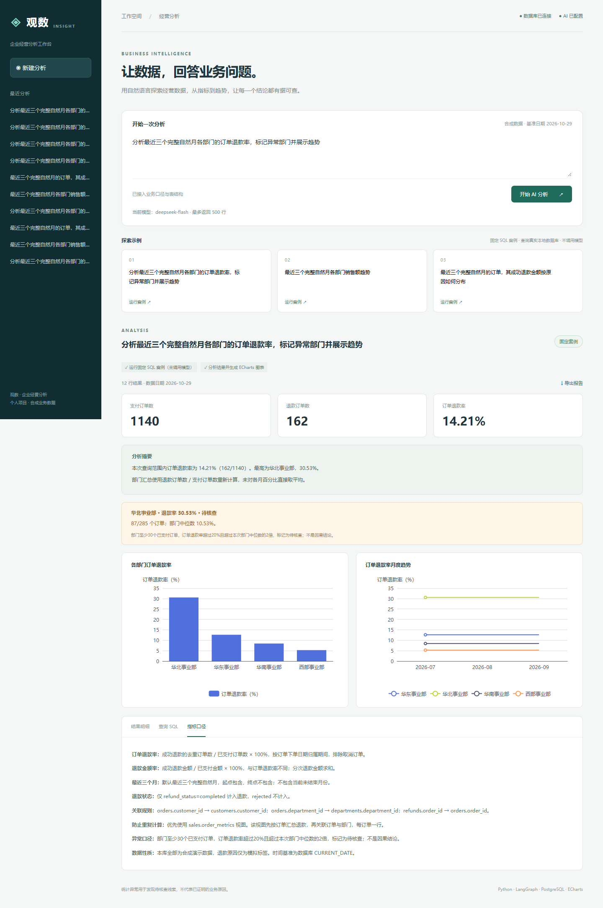
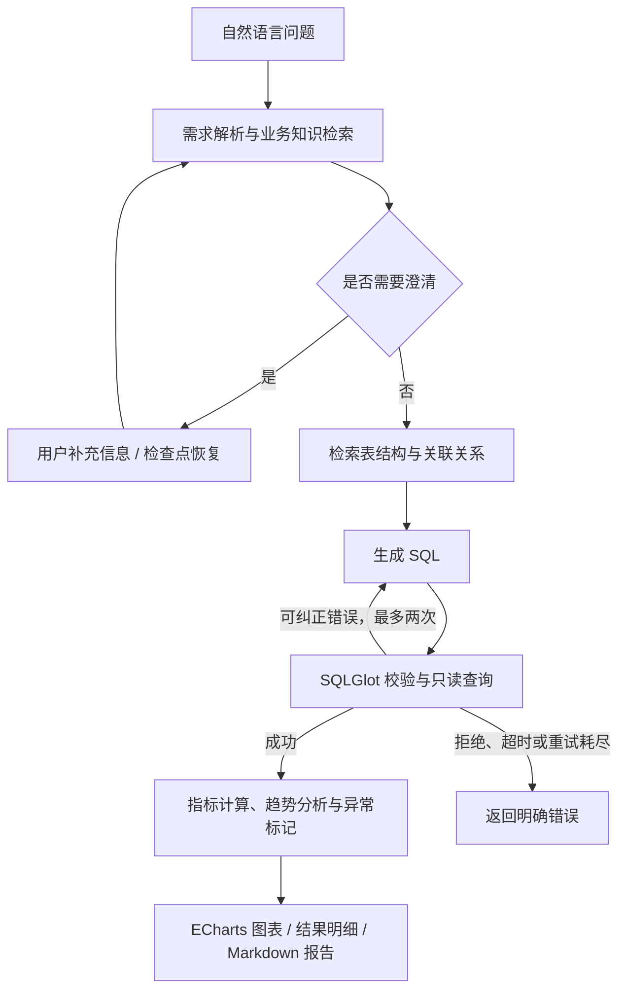

# 企业智能数据分析与可视化系统

使用自然语言查询经营数据，查看 SQL、指标口径与结果明细，并生成图表和分析报告。

基于 Python、FastAPI、LangGraph、PostgreSQL、SQLGlot 和 ECharts，覆盖从问题理解、业务目录检索、SQL 生成与校验，到数据分析、可视化及报告导出的完整流程。



## 核心功能

| 功能 | 说明 |
| --- | --- |
| 自然语言问数 | 将业务问题转化为 PostgreSQL 查询，支持销售、订单、退款等经营分析场景 |
| 业务语义与结构检索 | 结合指标定义、表结构、关联关系与 SQL 示例，识别查询所需的数据 |
| LangGraph 工作流 | 编排需求解析、知识检索、选表、SQL 生成和执行；错误分类后有限纠错，支持澄清与检查点恢复 |
| SQL 校验与只读执行 | SQLGlot AST 校验单语句、表字段与函数范围；结合数据库只读账号、只读事务、查询超时与结果行数限制 |
| 阶段进度与历史 | 后台执行任务，通过 SSE 展示阶段进度，保存查询历史和结果 |
| 数据分析与异常提示 | 基于实际查询结果计算指标、趋势变化与规则异常，保留计算依据 |
| 可视化与证据核验 | ECharts 展示趋势及分布，可查看执行 SQL、数据明细和指标口径 |
| 报告导出 | 下载包含分析摘要、异常依据、SQL、口径及结果明细的 Markdown 报告 |

## 工作流程



业务数据存储于 PostgreSQL，任务、阶段事件和 LangGraph 检查点持久化于本地 SQLite。
界面渲染结构化图表配置，不执行模型生成的 JavaScript。

## 示例问题

- 分析最近三个完整自然月各部门的订单退款率，标记异常部门并展示趋势。
- 最近三个完整自然月各部门销售额趋势。
- 最近三个完整自然月的订单，其成功退款金额按原因如何分布。

页面输入框执行真实模型问数；下方固定案例使用审核过的 SQL，可在未配置模型时体验数据库查询和图表。

## Windows 安装与启动

前置：Git、uv、Node.js 20.19+、已启动的 Docker Desktop（Linux 容器模式）。
先克隆仓库，再进入项目目录执行：

```powershell
git clone https://github.com/zcl-crypto/enterprise-data-analyst.git
cd enterprise-data-analyst
```

```powershell
$env:UV_CACHE_DIR = Join-Path (Get-Location) '.uv-cache'
uv sync --python 3.11 --no-dev --extra enterprise --extra test --no-editable --locked
.venv\Scripts\python -X utf8 -m enterprise.setup
Push-Location frontend
npm.cmd ci
npm.cmd run build
Pop-Location
.\start-enterprise.ps1
```

浏览器访问 http://127.0.0.1:8093 ，接口文档位于 `/docs`。
`--no-editable` 用于规避 Python 3.11 在 Windows 中文路径读取 editable `.pth` 文件时的编码问题。
业务源码仍从项目根目录导入，修改后重启服务即可。

启动脚本会启动本项目的 PostgreSQL 服务。首次启动初始化四张业务表、一张去重分析视图、
2,400 个订单及分次退款/拒绝退款数据，并创建 `analyst_reader` 只读角色。
所有数据均为合成数据；日期相对首次初始化当天生成，数据卷持久化后不会自动刷新。
数据库端口仅绑定 `127.0.0.1:55432`，Web 仅绑定本机。
停止数据库使用 `docker compose -f compose.enterprise.yaml stop`，该命令保留数据卷。

## 模型配置

`enterprise.setup` 只在 `.env` 不存在时生成随机的本地数据库密码，不覆盖已有配置。
在 `.env` 填写以下字段，保留其余数据库配置，然后重启 Web 服务：

```dotenv
LLM_API_KEY=你的密钥
LLM_BASE_URL=https://你的OpenAI兼容服务/v1
LLM_MODEL=服务支持的模型名称
SQL_TIMEOUT_MS=5000
SQL_MAX_ROWS=500
```

本项目已用 DeepSeek V4.1 Flash 完成联调，官方接口配置如下（API Key 仍填写到上面的 `LLM_API_KEY`）：

```dotenv
LLM_BASE_URL=https://api.deepseek.com
LLM_MODEL=deepseek-flash
```

模型 ID 使用 `deepseek-flash`，不是 `deepseek-flash4.1`；第三方平台请使用其公布的地址和模型 ID。

模型需要支持 Chat Completions 和工具调用。密钥不发到前端，也不提交到 Git。
服务请求超时为45秒，模型客户端最多重试一次；LangGraph SQL 最多修正两次。
业务口径和相关数据结构会发送给配置的模型服务。请先使用本项目合成数据联调。

未配置模型时：

- **AI 自由问数**返回明确的“模型未配置”错误，不伪造答案。
- **固定案例**使用预先审核的 SQL 实际查询 PostgreSQL，可验证图表、数据口径及导出，不调用模型，也不宣称是自然语言理解结果。

## 业务口径与演示

首个案例：最近三个完整自然月各部门订单退款率、异常部门与月度趋势。

- 订单退款率 = 成功退款的去重订单数 / 已支付订单数 × 100%。
- 按订单日期归属期间，排除当前未结束月份与取消订单。
- 仅计入 `completed` 退款，分次退款先按订单聚合，防止 JOIN 扩大分母。
- 金额退款率与订单退款率是不同指标，不能混用。
- 部门至少30个支付订单，订单退款率超过20%且超过本次部门中位数2倍，标记为待核查。
- 截断结果会明确提示，且关闭总体异常判断；异常标记不是因果分析结论。

另外两个案例展示销售额趋势、退款原因的金额分布。
每次分析均可以查看 SQL、结果明细、口径与报告。任务独立保存，不会把前一个任务的结果误当成新问题答案。
模型主动请求澄清时可补充信息，并从检查点恢复。跨独立任务的自由多轮对话尚未作为产品能力提供。

## 验证

```powershell
New-Item -ItemType Directory -Force .runtime\tmp | Out-Null
$env:TMP = Join-Path (Get-Location) '.runtime\tmp'
$env:TEMP = $env:TMP
.venv\Scripts\python -X utf8 -m pytest tests/enterprise tests/test_text2sql_generate_sql.py tests/test_text2sql_errors.py tests/test_config_loader.py -o addopts='' -q
.venv\Scripts\python -X utf8 -m enterprise.verify_workflow
Push-Location frontend
npx.cmd playwright test --reporter=line
Pop-Location
```

浏览器测试默认使用已安装的 Microsoft Edge，要求本地 Web 服务位于8093端口。
`verify_workflow` 只替换 LLM 响应，实际运行上游检索、LangGraph、校验器与 PostgreSQL；
覆盖 SQL 纠错、重试上限、安全拒绝、澄清中断与恢复。它不验证真实模型的生成质量。

模型配置完成后，运行：

```powershell
.venv\Scripts\python -X utf8 -m enterprise.verify_live
```

此命令调用真实模型处理三个业务问题，并将结果与审核过的 SQL 结果比较，可能产生模型费用。
结果写入 `.runtime/live-verification.json`，不以固定 SQL 替代模型输出。

如需从浏览器验证真实模型，可在 `frontend` 目录执行以下命令。该测试也会调用模型，默认浏览器回归不会执行它：

```powershell
$env:LIVE_MODEL_TEST = '1'
npx.cmd playwright test --reporter=line
Remove-Item Env:LIVE_MODEL_TEST
```

## 当前验证状态与边界

截至2026-10-29：

- 155项应用与核心工作流回归测试通过，包含输出通配符绕过字段白名单与业务提示词加载的回归测试。
- LangGraph + PostgreSQL 集成流程验证通过（模型响应为受控测试数据）。
- 3项浏览器端测试通过，覆盖图表、明细、报告下载、移动布局和未配置模型提示。
- 配置模型后的浏览器验收：3 passed、1 skipped，包含真实 AI 提问、阶段进度、退款率和异常图表、报告下载；未配置模型提示测试按条件跳过（配置前已验证）。演示截图见本文开头。
- DeepSeek `deepseek-flash` 的三个真实模型案例全部通过：退款率趋势12行、销售趋势12行、退款原因3行；逐列、逐行与审核 SQL 结果比较一致。这是三个固定案例的验证，不代表任意问题的准确率。

本版本面向本机个人演示，尚未提供多租户、企业登录、行级授权或生产部署。
业务允许访问范围是服务配置中的表字段策略，不是按登录用户动态授权。
统计分析以返回数据为依据，但 SQL 是否正确表达业务意图仍需通过业务验收与模型评测验证。

主要应用目录：`enterprise/`、`frontend/`、`tests/enterprise/`。
截图、测试日志、查询历史和检查点位于 `.runtime/`，已加入忽略规则。

## 目录结构

```text
enterprise/                 API、业务语义、分析报告、任务存储及验证脚本
  db/                       PostgreSQL 建表、合成数据与只读账号初始化
  catalog/                  业务目录、字段定义及 SQL 示例
frontend/                   ECharts 界面与浏览器测试
openchatbi/                  核心 Agent、检索与 LangGraph 工作流
  text2sql/sql_guard.py      SQL AST 校验
  text2sql/readonly.py       只读执行与查询限制
tests/enterprise/           应用、安全与数据库测试
compose.enterprise.yaml     本地 PostgreSQL 服务
start-enterprise.ps1        Windows 启动入口
```

## 配置与敏感信息

本仓库不提供 API Key。运行 `python -m enterprise.setup` 后，在本地 `.env` 中填写自己的模型配置。
`.env`、运行日志、查询历史、检查点、虚拟环境和依赖缓存不提交到仓库。
请勿将密钥写入前端、代码、截图或 Issue；公开问题反馈请先脱敏。

## 许可证与致谢

本项目基于 [OpenChatBI](https://github.com/zhongyu09/openchatbi) 构建，遵循 [MIT 许可证](LICENSE)，保留原作者版权声明。来源版本及说明见 [THIRD_PARTY_NOTICES.md](THIRD_PARTY_NOTICES.md)。
